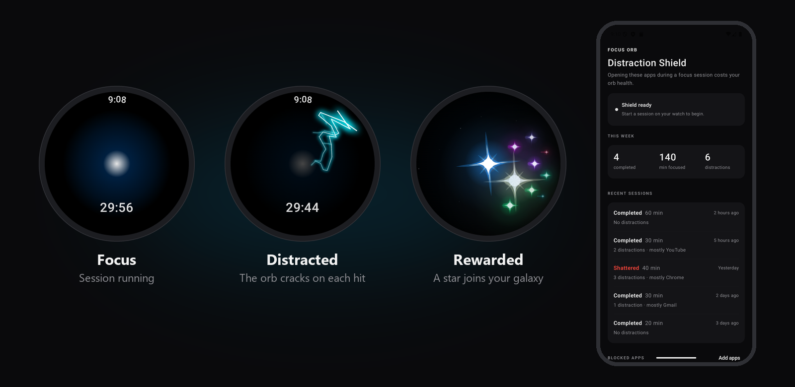
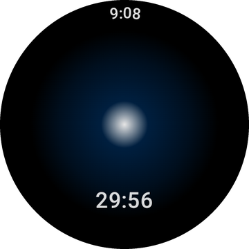
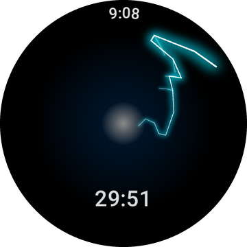
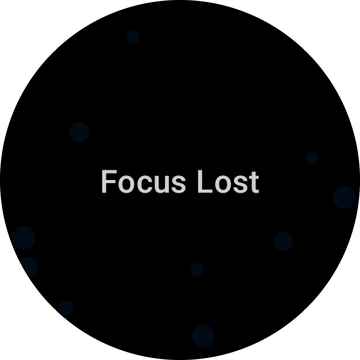
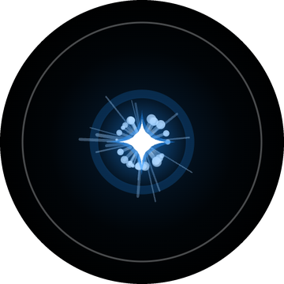
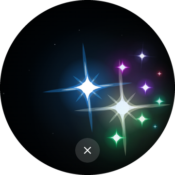
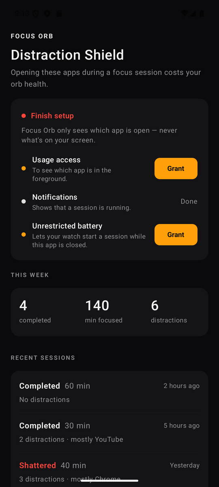
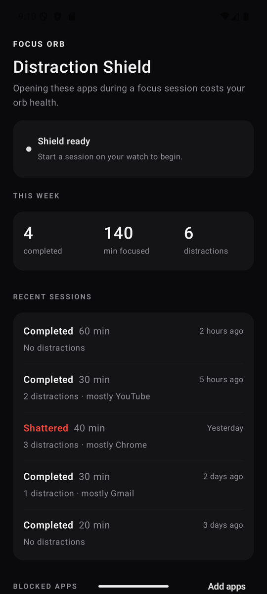
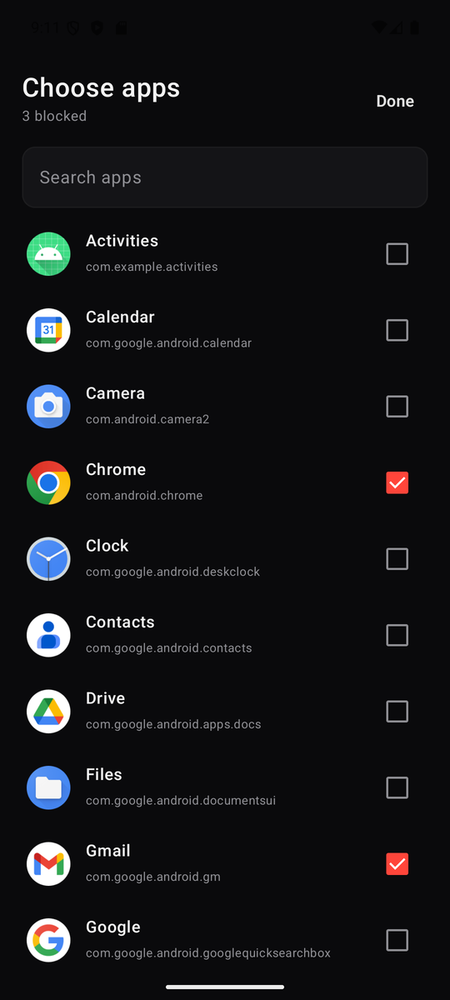
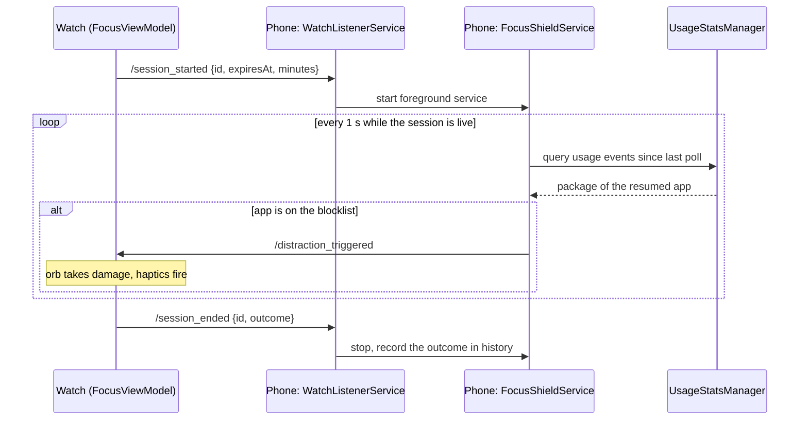

<p align="center">
  
  
  
  
</p>

# FocusOrb

**An anti-distraction system for Wear OS + Android.**

Start a focus session on your watch, and your phone becomes a referee. It detects when you open a distracting app and signals the watch, where your orb takes damage. Complete a session to earn a star for your personal galaxy.

<p align="center">
  
</p>

---

## How It Works

FocusOrb is a **dual-device** system: two apps that talk in real time over the Wearable Data Layer.

### Watch — *The Focus Orb*
A glowing, animated energy orb lives on your wrist. Start a focus session and the orb pulses with life. Stay focused, and the orb rewards you. Get distracted, and it fights back.

### Phone — *The Distraction Shield*
While a session is active, the phone runs a foreground service that checks which app is in front, once a second. Open an app on your blocklist and the phone signals the watch within about a second. It doesn't stop you using the app; it makes you pay for it on your wrist.

### The Penalty System
- The orb has **3 Health Points**.
- Each distraction triggers **screen shake**, **crystalline fracture visuals**, and **heavy haptic feedback** on the watch.
- Stay inside a blocked app and a **Poison Tick** deals repeated damage every 5 seconds.
- Lose all HP → the orb **shatters** and your session is lost.

<p align="center">
  
  
  
</p>

### The Reward
Complete a session and the orb **collapses into a supernova**, birthing a collectible star. Stars are placed into an interactive, scrollable **2D hex-spiral galaxy** you build over time.

<p align="center">
  
  
  
</p>

| Duration | Reward |
|:--------:|:------:|
| 20 min   |  Small Star |
| 30 min   | Medium Star |
| 40 min   |  Large Star |
| 60 min   |  Epic Star  |

### On the phone
Set up the shield once, choose any installed app to block, and see how each session went.

<p align="center">
  
  
  
</p>

---

## Key Features

- **Dynamic Canvas Orb** — Breathing radial gradient animations with real-time fracture rendering on damage
- **Ambient Mode Support** — Ongoing Activity API keeps the session alive when you lower your wrist (Wear OS 3+)
- **Interactive Star Galaxy** — Fling-scrollable hex-grid layout with fish-eye lens magnification
- **Supernova Animation** — Explosive reward animation on session completion, with haptics timed to the visual beats
- **Distraction Detection without screen access** — `UsageStatsManager` reports only *which* app is in front, never what's on screen ([why this matters](#why-not-an-accessibility-service))
- **Block any app** — Searchable picker over every launchable app, with one-tap suggestions for common time sinks
- **Session history** — Weekly totals and a per-session log: outcome, distraction count, and the app that distracted you most
- **Resilient sync** — Sessions carry an ID and an expiry, so pausing stops the penalties and a dead watch app can't leave the phone policing you forever

---

## Architecture



### Why not an Accessibility Service?

The first version detected the foreground app with an `AccessibilityService`, the usual approach for app blockers. It worked, but it had a serious side effect: **UPI and banking apps refuse to run while a screen-reading accessibility service is enabled.** Accessibility services can read and act on anything on screen, which makes them a known fraud vector, so payment apps treat any enabled service as a threat. With FocusOrb installed, payments stopped working.

Detection now uses `UsageStatsManager`. Usage events carry only a package name and an event type. There is no screen content to read, so there's nothing for a payment app to flag. The trade-offs:

| | Accessibility Service | Usage Access (current) |
|---|---|---|
| Sees screen content | Yes | **No** |
| Breaks UPI / banking apps | Yes | **No** |
| Detection | Event-driven, instant | Polled every 1 s |
| Runs | Always, system-bound | Only during a session, as a foreground service |
| Background start on Android 12+ | Not needed | Needs a battery-optimisation exemption |

The last row is the real cost. Android 12+ won't let an app start a foreground service from the background, which is exactly what happens when the watch starts a session. Exempting the app from battery optimisation is one of the documented exceptions, so the setup screen asks for it with a one-tap system dialog.

---

## Project Structure

```
FocusOrb/
├── app/                              # Wear OS watch app
│   └── src/main/.../presentation/
│       ├── MainActivity.kt           # Compose Canvas UI: orb, supernova, galaxy
│       ├── FocusViewModel.kt         # Session timer, state, star rewards
│       ├── SessionMessage.kt         # Wire format for session messages
│       ├── PhoneBridgeManager.kt     # Sends session signals to the phone, in order
│       ├── DistractionMessageReceiver.kt  # Receives distraction hits from the phone
│       └── OngoingActivityManager.kt # Ambient Mode persistence
│
├── focusorb/                         # Android phone companion app
│   └── src/main/.../
│       ├── WatchListenerService.kt   # Receives session start/end from the watch
│       ├── SessionSignalHandler.kt   # What the phone does on start/end
│       ├── FocusShieldService.kt     # Foreground service: polls, penalises
│       ├── ForegroundAppTracker.kt   # UsageStatsManager → current foreground app
│       ├── WatchBridgeManager.kt     # Sends distraction signals to the watch
│       ├── SessionStateStore.kt      # Active session, with expiry
│       ├── SessionHistoryStore.kt    # Per-session log and weekly totals
│       ├── BlocklistStore.kt         # Blocked apps
│       ├── InstalledAppsRepository.kt # Launchable apps for the picker
│       └── ui/                       # Dashboard, setup checklist, history, picker
│
└── docs/screenshots/                 # README images
```

---

## Tech Stack

| Layer | Technology |
|-------|------------|
| Language | Kotlin 2.0 |
| Watch UI | Jetpack Wear Compose + Canvas API |
| Phone UI | Jetpack Compose Material 3 |
| Architecture | MVVM (ViewModel + StateFlow) |
| Communication | Google Play Services Wearable (MessageClient) |
| Detection | UsageStatsManager, polled from a `specialUse` foreground service |
| Background | Foreground service, WearableListenerService |
| Concurrency | Kotlin Coroutines, Channels, Mutex |
| Persistence | SharedPreferences (JSON via `org.json` for history) |
| Build System | Gradle (KTS) with Version Catalog |

---

## Getting Started

### Install the APKs

Download `FocusOrb-watch` and `FocusOrb-phone` from the [latest release](https://github.com/Kushal-MR/FocusOrb/releases/latest). They are debug-signed, so Android will ask you to allow installs from unknown sources.

### Build from source

**Prerequisites:** Android Studio (Ladybug or newer), a Wear OS device or emulator (API 30+), and an Android phone or emulator (API 28+).

1. **Clone the repository**
   ```bash
   git clone https://github.com/Kushal-MR/FocusOrb.git
   cd FocusOrb
   ```
2. **Open in Android Studio** and let Gradle sync.
3. **Run the watch app**: select the `app` module and deploy to a Wear OS device or emulator.
4. **Run the phone app**: select the `focusorb` module and deploy to a phone.
5. **Pair the devices** through the Wear OS companion app.

### Set up the phone

Open FocusOrb on the phone and complete the three-step checklist:

1. **Usage access**: lets the shield see which app is in the foreground.
2. **Notifications**: a "Focus session active" notification shows while the shield is running.
3. **Unrestricted battery**: lets your watch start a session while the phone app is closed.

Then add apps to your blocklist and start a session from the watch.

---

## Permissions

| Permission | Device | Purpose |
|------------|--------|---------|
| `WAKE_LOCK` | Watch | Keep the screen on during damage and completion animations |
| `VIBRATE` | Watch | Haptic feedback on distraction hits |
| `POST_NOTIFICATIONS` | Watch | Ongoing Activity for Ambient Mode |
| `PACKAGE_USAGE_STATS` | Phone | See which app is in the foreground (never screen content) |
| `FOREGROUND_SERVICE`, `FOREGROUND_SERVICE_SPECIAL_USE` | Phone | Run the shield for the length of a session |
| `POST_NOTIFICATIONS` | Phone | Show the "Focus session active" notification |
| `REQUEST_IGNORE_BATTERY_OPTIMIZATIONS` | Phone | Let the watch start the shield in the background |

The phone app lists other apps through a `<queries>` entry for launcher intents rather than `QUERY_ALL_PACKAGES`. It can only see apps that have a launcher icon.

---

## Known Limitations

- **Detection is polled**, so there can be up to about a second between opening a blocked app and the hit.
- **The battery exemption is required** for sessions to start while the phone app is closed. Without it, Android refuses the background start (the app logs this rather than crashing).
- **FocusOrb detects, it doesn't block.** You can still use a blocked app; the cost is your orb's health.

---

## License

This project is open source. Feel free to explore, learn from, and build upon it.

---

<p align="center">
  <b>Stay focused. Earn stars. Build your galaxy.</b> 🌌
</p>
